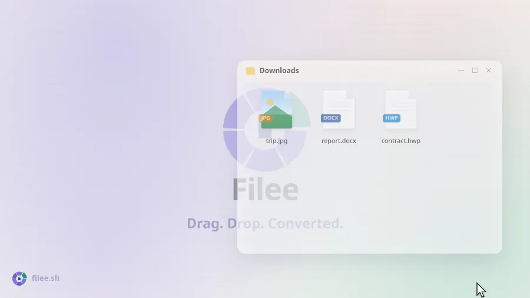
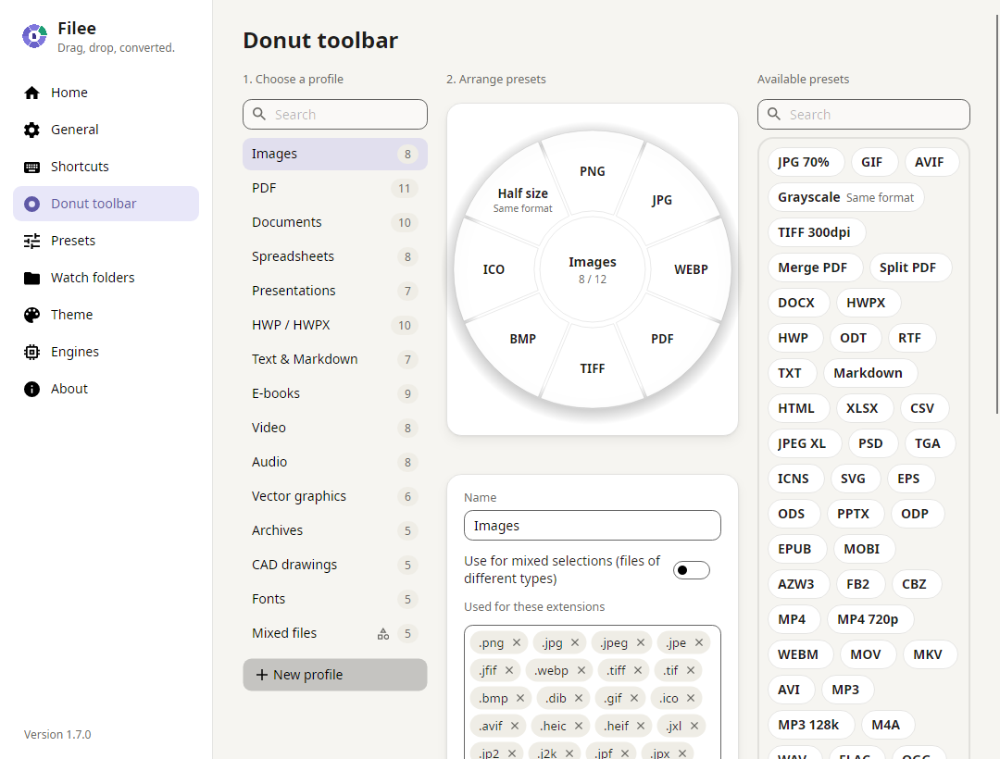

<p align="center">
  <a href="https://filee.sh"></a>
</p>

<p align="center" dir="rtl">
  <b>محوّل ملفات مجاني ومفتوح المصدر تستخدمه بالسحب.</b><br>
  اضغط باستمرار على مفتاح (<kbd>Ctrl</kbd>، أو <kbd>Option</kbd> على macOS)، واسحب الملفات وأفلتها على صيغة في القائمة الدائرية التي تظهر عند المؤشر.
</p>

<p align="center" dir="rtl">
  <a href="https://filee.sh"><b>الموقع</b></a> ·
  <a href="https://github.com/WDHUS4G/Filee/releases/latest"><b>تنزيل</b></a> ·
  <a href="https://www.linkedin.com/company/filee-sh/"><b>LinkedIn</b></a> ·
  <a href="#التثبيت">التثبيت</a> ·
  <a href="#سطر-الأوامر">سطر الأوامر</a> ·
  <a href="#التطوير">التطوير</a>
</p>

<p align="center" dir="ltr">
  <a href="https://github.com/WDHUS4G/Filee/actions/workflows/ci.yml"></a>
  <a href="https://github.com/WDHUS4G/Filee/releases/latest"></a>
  <a href="https://github.com/WDHUS4G/Filee/releases"></a>
  
  
  
  <a href="LICENSE"></a>
</p>

<p align="center" dir="ltr">
  <a href="https://trendshift.io/repositories/276987"></a>
  <a href="https://trendshift.io/repositories/276987"></a>
</p>

<p align="center" dir="ltr">
  <a href="README.md">English</a> ·
  <a href="README.es.md">Español</a> ·
  <a href="README.ja.md">日本語</a> ·
  <a href="README.ko.md">한국어</a> ·
  <a href="README.zh-CN.md">简体中文</a> ·
  <a href="README.zh-TW.md">繁體中文</a> ·
  <a href="README.pl.md">Polski</a> ·
  <a href="README.hi.md">हिन्दी</a> ·
  <a href="README.ru.md">Русский</a> ·
  <b>العربية</b> ·
  <a href="README.pt-BR.md">Português (Brasil)</a> ·
  <a href="README.pt-PT.md">Português (Portugal)</a> ·
  <a href="README.fr.md">Français</a> ·
  <a href="README.th.md">ไทย</a>
</p>

<div dir="rtl">

<table>
  <tr>
    <td width="33%" valign="top">
      <b>عند المؤشر مباشرةً</b><br>
      لا نافذة تطبيق عليك فتحها.
      تظهر الصيغ حيث أنت، ولا يظهر منها إلا ما يناسب الملفات التي تسحبها.
    </td>
    <td width="33%" valign="top">
      <b>263 صيغة دون برامج أخرى</b><br>
      الصور وPDF وWord وExcel وPowerPoint وHWP والكتب الإلكترونية والأرشيفات والخطوط وCAD والنماذج ثلاثية الأبعاد والبيانات الجغرافية، كلها تعمل دون Office أو Hancom Office أو LibreOffice.
    </td>
    <td width="33%" valign="top">
      <b>يبقى على جهازك</b><br>
      لا يُرفع أي شيء.
      يعمل Filee دون اتصال بالإنترنت ويحفظ النتيجة بجانب الملف الأصلي.
    </td>
  </tr>
</table>

## شاهده وهو يعمل

<p align="center">
  <a href="https://filee.sh"></a><br>
  <sub>شاهد الفيديو (27 ثانية) وجرّب العرض التفاعلي على <a href="https://filee.sh">filee.sh</a></sub>
</p>

## التثبيت

نزّله من صفحة [الإصدارات](https://github.com/WDHUS4G/Filee/releases/latest).

- **Windows 10/11**: شغّل `Filee-<version>-win-Setup.exe`، أو فكّ ضغط `win-Portable.zip` وشغّل `Filee.exe`.
  - برنامج الإعداد خاص بـ Filee، ويعمل بلغات Filee، ولا يحتاج إلى أي شيء آخر على الكمبيوتر.
  - يمكنه إضافة قائمة مستكشف الملفات، والتشغيل عند تسجيل الدخول، والأمر `filee`، والمحركات الاختيارية.
  - وتقبل عمليات التثبيت الصامت مفاتيح Inno Setup نفسها (`/VERYSILENT /SUPPRESSMSGBOXES`).
- **macOS 13 أو أحدث** (إصدار تجريبي): فكّ ضغط حزمة `osx-arm64` أو `osx-x64` وشغّل `./install.sh`.
  - أو افتح ملف `.dmg` واسحب Filee إلى مجلد التطبيقات (يضيف `install.sh` وحده الأمر `filee`).
  - لم تُوثّق Apple هذا الإصدار بعد (notarization)، لذا اسمح بالتشغيل الأول من إعدادات النظام ← الخصوصية والأمن ← **فتح على أي حال**.
- **Linux x64/ARM64** (Ubuntu 22.04 أو أحدث): فكّ ضغط الحزمة وشغّل `./install.sh` (لا يحتاج إلى root، ويحتاج إلى Python 3).
  - تعمل إيماءات السحب على X11.
    أما على Wayland فاستخدم منطقة الإفلات وقائمة النقر بالزر الأيمن في مدير الملفات.

يعرض Filee الإصدارات الجديدة في قائمته ويحدّث نفسه، مع الإبقاء على إعداداتك ومحركاتك.
وبعد التحديث تعرض بضع شرائح ما الجديد فيه.

**لا يعمل Filee على Windows (لا نافذة ولا رسالة خطأ)؟**
يحدث هذا على Windows 10 لم يُحدَّث منذ مدة طويلة، في جهاز يدعم معالجه حماية المكدس المفروضة بالأجهزة (CET).
يشغّل Windows هذه الحماية لكنه يفتقد جزءًا يحتاجه ‎.NET، فيتوقف Filee وبرنامج الإعداد فورًا.

- **المستحسن:** ثبّت تحديثات Windows المتاحة (أحدث تحديث تراكمي).
- **إن تعذّر التحديث:** فإيقاف الحماية لـ Filee وحده يفي بالغرض عادةً.
  شغّل ما يلي في PowerShell بصلاحيات المسؤول:

</div>

```powershell
Set-ProcessMitigation -Name Filee.exe -Disable UserShadowStack
Set-ProcessMitigation -Name filee-cli.exe -Disable UserShadowStack
```

<div dir="rtl">

افعل الشيء نفسه مع اسم ملف برنامج الإعداد (مثل `Filee-<version>-win-Setup.exe`)، أو استخدم ملف ZIP المحمول الذي يكفيه هذان السطران.
وللتراجع، احذف هذه الإدخالات من أمن Windows ← التحكم في التطبيقات والمستعرض ← إعدادات الحماية من الاستغلال ← إعدادات البرنامج.

## الميزات

- **قائمة دائرية عند المؤشر**: اضغط باستمرار على مفتاح، واسحب الملفات وأفلتها على صيغة.
  لا تظهر إلا الصيغ التي تناسب الملفات.
- **مباشرةً من المتصفح**: اسحب بالطريقة نفسها صورة أو رابط ملف أو تنزيلًا من Chrome أو Edge أو Firefox أو Safari.
  - يحفظه Filee في مجلد التنزيلات (أو يحتفظ بالملف المحوّل وحده) ثم يحوّله.
  - تُنزَّل الروابط دون استخدام تسجيل الدخول في متصفحك.
- **شريط أدوات دائري لكل نوع ملف**، ترتّبه بالسحب والإفلات، مع إعدادات مسبقة لما يلي:
  - الجودة والحجم والدقة (DPI)
  - صفحات PDF وضغطه
  - الفيديو والصوت
  - مجلد الحفظ وأسماء الملفات
- **وجهان لكل قائمة دائرية**: اضغط <kbd>Tab</kbd> أو أدر عجلة الماوس أثناء فتحها لتقلبها إلى الصيغ والأدوات الأقل استخدامًا.
- **الاقتصاص قبل التحويل**: يفتح خيار «اقتصاص» الصور واحدةً تلو الأخرى.
  اسحب الإطار واختر نسبة الأبعاد، فلا يُحفظ إلا ذلك الجزء.
- **ملفات كثيرة دفعةً واحدة**، بالتوازي.
  ويعثر Filee تلقائيًا على مسارات التحويل متعددة الخطوات (HWP → HWPX → DOCX).
- **مراقبة المجلدات**: يُحوَّل كل ملف يصل إلى المجلد المراقَب.
- **التحويلات الأخيرة** في الصفحة الرئيسية، لكل نتيجة صورة مصغّرة: افتح الملف، أو افتحه باستخدام تطبيق آخر.
- **طرق أخرى**: قائمة النقر بالزر الأيمن، واختصار لوحة المفاتيح، ومنطقة الإفلات، و[الأمر `filee`](#سطر-الأوامر).
- مظهر فاتح وداكن، باللون المميّز وشفافية الشريط الدائري اللذين تختارهما، وباللغات: English · Español · 日本語 · 한국어 · 简体中文 · 繁體中文 · Polski · हिन्दी · Русский · العربية (من اليمين إلى اليسار) · Português (Brasil) · Français · नेपाली · ไทย · Türkçe · Português (Portugal).

## لقطات الشاشة

<table>
  <tr>
    <td width="50%"></td>
    <td width="50%"></td>
  </tr>
  <tr>
    <td align="center"><sub>رتّب القائمة الدائرية بالسحب والإفلات، بملف تعريف لكل نوع ملف</sub></td>
    <td align="center"><sub>الرئيسية: منطقة الإفلات والتحويلات الأخيرة</sub></td>
  </tr>
</table>

## الصيغ

| من | إلى |
|---|---|
| **الصور**: JPG, PNG, WEBP, AVIF, TIFF, BMP, GIF, APNG, ICO, ICNS, JPEG XL, JPEG 2000, PSD/PSB, TGA, PPM, HEIC, QOI, DDS, PCX, MNG, CUR وغيرها؛<br>وللقراءة: GIMP XCF، وصور RAW من الكاميرات (CR2, CR3, NEF, ARW, DNG وغيرها)، وDICOM وOpenEXR وHDR وFITS (صور فلكية)، وJPEG XR (على Windows)، وLive Photo من iPhone (LIVP) | أيٌّ منها (HEIC⁵)، PDF، SVG (بالتتبّع)، تغيير الحجم، تدرّج رمادي؛<br>صور Live/Motion Photo (iPhone وAndroid) إلى الفيديو الذي تحمله (MP4, MOV⁵)، ومن فيديو إلى Live Photo (iPhone) أو Motion Photo (Android)⁵، ميزة تجريبية |
| **الرسومات المتجهية**: SVG, SVGZ, EMF, WMF, AI<br>EPS, PS¹<br>CDR, VSD, CGM, ODG, FODG² | PDF (متجهي)، PNG وصور أخرى،<br>SVG ↔ SVGZ، SVG → DXF/DWG، PDF → EPS/PS¹، SVG → EMF, WMF, ODG² |
| **PDF** | DOCX, HWPX, TXT, PNG, JPG, TIFF, CBZ، PPTX (صورة لكل صفحة)، SVG²؛<br>الدمج (بترتيب تختاره أولًا)، التقسيم، نطاقات الصفحات، الضغط (ملفات PDF أصغر) |
| **المستندات**: DOCX, DOCM, DOTX, EML, Outlook MSG؛<br>وOFD للقراءة (الفواتير الإلكترونية والمستندات الرسمية الصينية)<br>DOC, ODT, FODT, OTT, RTF, WPS, WPD, Pages, ClarisWorks, MacWrite, T602 وغيرها² | PDF, DOCX, HWPX, EPUB, TXT, HTML؛<br>MSG → EML<br>ODT, FODT, OTT² |
| **جداول البيانات**: XLSX, XLSM, XLS, XLT, ODS, CSV, TSV<br>OTS, FODS, Numbers, ET² | PDF, XLSX, ODS, CSV, TSV, JSON, HWPX, HTML<br>XLT, OTS² |
| **العروض التقديمية**: PPTX, PPTM, POTX, POTM, PPSX<br>PPT, ODP, OTP, FODP, Keynote² | PDF, PNG, JPG, DOCX, HWPX<br>OTP² |
| **HWP**: HWP, HWPX | PDF, PNG, DOCX, HWPX ↔ HWP, TXT, Markdown, HTML |
| **النصوص**: TXT وLOG، والشيفرة المصدرية للسكربتات (PY, PAC, BAT, COMMAND؛ تُقرأ ولا تُشغَّل أبدًا)، وMarkdown وHTML؛<br>وMHTML للقراءة (صفحات الويب المحفوظة)<br>reStructuredText, LaTeX, Org, AsciiDoc, Typst, MediaWiki, DocBook, Jupyter, Textile, man, OPML³ | TXT بترميز UTF-8، PDF, DOCX, HWPX, EPUB<br>فيما بينها، شرائح PPTX³ |
| **الكتب الإلكترونية**: EPUB, KEPUB, MOBI, AZW3, AZW, AZW4, FB2, CBZ, CBR, CB7, HTMLZ, TXTZ<br>LIT, LRF, CHM, PDB وغيرها⁴ | PDF, EPUB، KEPUB (Kobo)، DOCX, TXT, HTML, HWPX<br>MOBI, AZW3⁴ |
| **الفيديو**⁵: MP4, MOV, MKV, WEBM, AVI, WMV, FLV, MPEG، وVideo CD (DAT)، وTS, M2TS, 3GP, OGV, VOB وغيرها | MP4 (H.264, HEVC, AV1)، WEBM, MOV, MKV, AVI, GIF, APNG, MP3, M4A، دقة 720p،<br>الترجمة (SRT, ASS, WebVTT) |
| **الصوت**⁵: MP3, M4A, AAC, WAV, FLAC, OGG, OPUS, WMA, AIFF, AMR, APE, WavPack, TTA، وDSD (DSF, DFF)، وDTS, AC3, E-AC3 وغيرها | MP3، M4A (AAC, ALAC)، WAV, FLAC, OGG, OPUS, AAC, WavPack, TTA, W64, AC3, E-AC3 |
| **الترجمة**: SRT, ASS/SSA, WebVTT، SAMI (SMI)، LRC, TTML, MicroDVD, SCC | فيما بينها بترميز UTF-8 (تُقرأ ملفات CP949 الكورية بشكل صحيح) |
| **الأرشيفات**: ZIP، وANSYS Workbench (WBPZ)، و7Z, RAR, TAR, TAR.GZ, TAR.BZ2, TAR.XZ, GZ, ISO, CAB, DMG, ALZ, EGG وغيرها | الاستخراج، ZIP, 7Z, TAR, TAR.GZ؛<br>وجمع أي ملفات في ZIP واحد |
| **CAD**: DWG, DXF | PDF, SVG, PNG, DWG ↔ DXF |
| **الخطوط**: TTF, OTF, WOFF, WOFF2, EOT | فيما بينها |
| **البيانات**: JSON, JSON Lines, YAML, TOML, XML<br>vCard, iCalendar | فيما بينها، وإلى CSV وXLSX (للجداول)؛<br>vCard, iCalendar ↔ CSV |
| **النماذج ثلاثية الأبعاد**: GLB, glTF, STL, OBJ (+ MTL), 3MF, PLY؛<br>وFBX للقراءة | فيما بينها، معاينة PNG |
| **البيانات الجغرافية المتجهية**: Shapefile, GeoJSON, KML, KMZ, GPX<br>ملفات CSV فيها إحداثيات | فيما بينها، وإلى CSV / XLSX / JSON؛<br>وتُحوَّل البيانات المُسقَطة (UTM, Web Mercator, Lambert, Albers) إلى خطوط الطول والعرض في WGS 84 |

الصيغ غير المعلَّمة تعمل مباشرةً، دون Office أو Hancom Office أو LibreOffice.
أما المعلَّمة فتحتاج إلى محرك اختياري لا يُنزَّل إلا عند الحاجة: ¹ Ghostscript، ² LibreOffice، ³ Pandoc، ⁴ calibre، ⁵ FFmpeg ([التفاصيل](docs/ENGINES.md)).

## سطر الأوامر

يستخدم الأمر `filee` المحركات والإعدادات المسبقة نفسها التي يستخدمها التطبيق (يضيفه برنامج الإعداد أو `install.sh`).

</div>

```
filee convert photo.heic --to jpg
filee convert *.png --to webp --quality 80 -o converted
filee watch D:\Inbox --to pdf --move-originals
```

<div dir="rtl">

جميع الأوامر والخيارات: [filee.sh/cli](https://filee.sh/cli/) أو `filee help`.

## التطوير

ابنِه باستخدام .NET 10 SDK على Windows أو macOS أو Linux:

</div>

```bash
git clone https://github.com/WDHUS4G/Filee.git
cd Filee
pwsh build/fetch-engines.ps1 -Only rhwp,pandoc   # optional engines
dotnet run --project src/Filee.App
dotnet test
```

<div dir="rtl">

[البنية](docs/ARCHITECTURE.md) · [المحركات](docs/ENGINES.md) · [إضافة محوّل](docs/ADDING-A-CONVERTER.md) · [إضافة لغة](docs/ADDING-A-LANGUAGE.md) · [المساهمة](CONTRIBUTING.md)

طلبات الدمج (pull requests) مرحّب بها.
وإذا وفّر عليك Filee بعض النقرات، فنجمة ⭐ تساعد الآخرين على العثور عليه.

## سياسة توقيع الشيفرة

يطوّر Filee وينشره **Myeonggu Kim** ([KnifeLemon](https://github.com/KnifeLemon)).

- تُوقَّع إصدارات Windows بشهادة توقيع شيفرة للمشاريع مفتوحة المصدر من [Certum](https://www.certum.eu/) صادرة باسم Myeonggu Kim.
  - الإصدارات حتى 2.0.0 غير موقَّعة.

السياسة الكاملة وسياسة الخصوصية في [README الإنجليزي](README.md#code-signing-policy).
لا يرفع Filee ملفاتك ولا يرسل أي بيانات استخدام.

## ادعم المشروع

Filee مجاني وسيبقى مجانيًا.
إذا أردت دعمه، فاختر الطريقة التي تناسبك ([Fairy](https://fairy.hada.io/@filee) يقبل البطاقات الكورية وخدمات الدفع السريع).

**اسمك أو شعارك هنا.**
يُدرَج الداعمون الشهريون هنا بأسمائهم، ويحصل الرعاة على شعارهم هنا وفي صفحة «حول التطبيق» في Filee.
ويمكن لمن يدعم مرة واحدة أن يطلب إدراج اسمه أيضًا.

</div>

<!-- sponsors: src/Filee.App/Assets/Sponsors/sponsors.json -->

<p align="center" dir="ltr">
  <a href="https://github.com/sponsors/KnifeLemon"></a>
  <a href="https://patreon.com/KnifeLemon"></a>
  <a href="https://ko-fi.com/knifelemon"></a>
  <a href="https://paypal.me/knifelemon"></a>
  <a href="https://fairy.hada.io/@filee"></a>
</p>

<div dir="rtl">

## الترخيص

MIT، © 2026 Myeonggu Kim (KnifeLemon) والمساهمون في Filee.
تحتفظ مكونات الجهات الخارجية المضمّنة بتراخيصها الخاصة، وهي مدرجة في [THIRD-PARTY-NOTICES.md](THIRD-PARTY-NOTICES.md).

</div>

<p align="center">
  <a href="https://star-history.com/#WDHUS4G/Filee&Date"></a>
</p>
