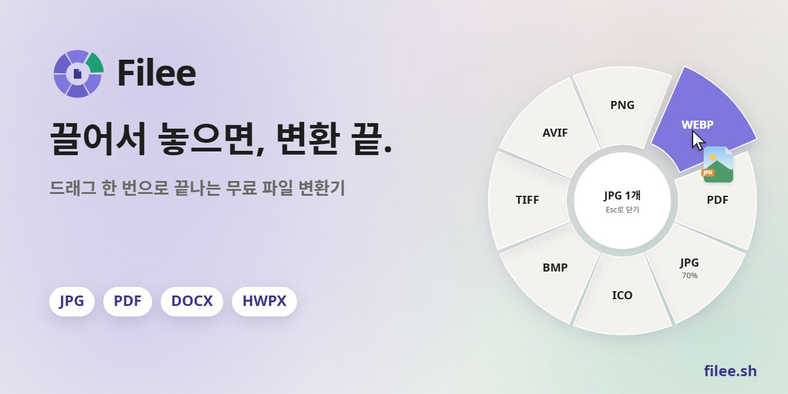
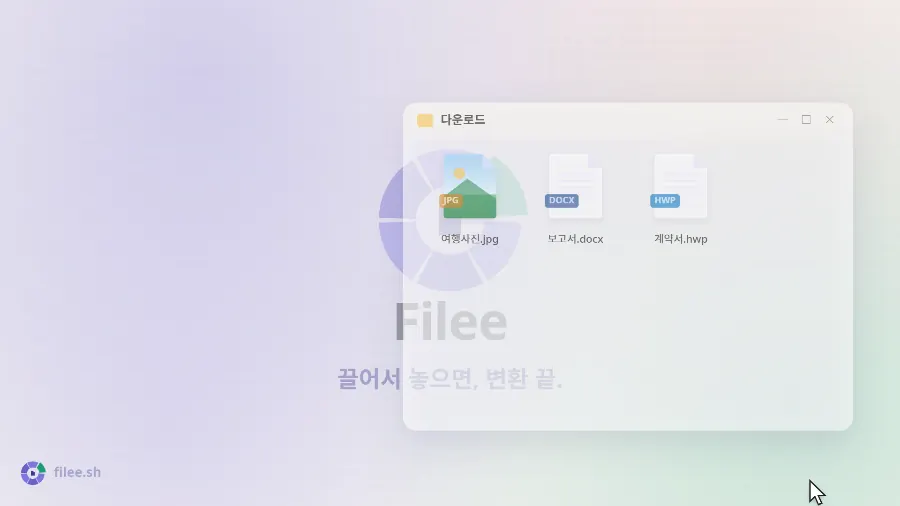
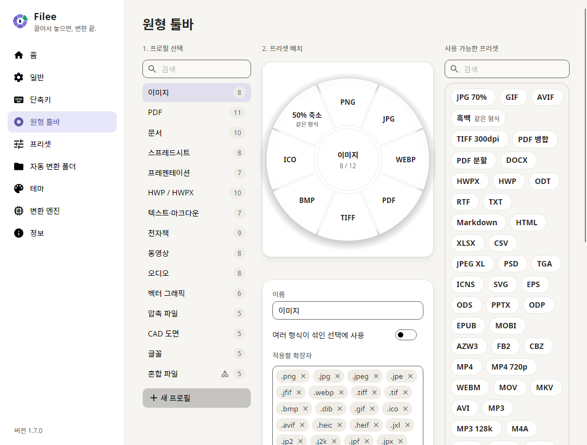
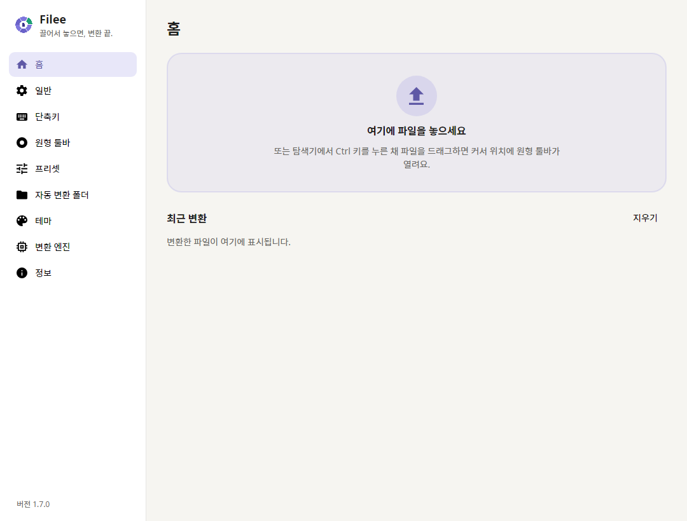

<p align="center">
  <a href="https://filee.sh/ko/"></a>
</p>

<p align="center">
  <b>드래그로 쓰는 무료 오픈소스 파일 변환기.</b><br>
  키(<kbd>Ctrl</kbd>, macOS는 <kbd>Option</kbd>)를 누른 채 파일을 끌면 커서 위치에 도넛이 열려요.
  원하는 형식 위에 놓으면 끝.
</p>

<p align="center">
  <a href="https://filee.sh/ko/"><b>웹사이트</b></a> ·
  <a href="https://github.com/WDHUS4G/Filee/releases/latest"><b>다운로드</b></a> ·
  <a href="https://www.linkedin.com/company/filee-sh/"><b>LinkedIn</b></a> ·
  <a href="#설치">설치</a> ·
  <a href="#명령줄">명령줄</a> ·
  <a href="#개발">개발</a>
</p>

<p align="center">
  <a href="https://github.com/WDHUS4G/Filee/actions/workflows/ci.yml"></a>
  <a href="https://github.com/WDHUS4G/Filee/releases/latest"></a>
  <a href="https://github.com/WDHUS4G/Filee/releases"></a>
  
  
  
  <a href="LICENSE"></a>
</p>

<p align="center">
  <a href="https://trendshift.io/repositories/276987"></a>
  <a href="https://trendshift.io/repositories/276987"></a>
</p>

<p align="center">
  <a href="README.md">English</a> ·
  <a href="README.es.md">Español</a> ·
  <a href="README.ja.md">日本語</a> ·
  <b>한국어</b> ·
  <a href="README.zh-CN.md">简体中文</a> ·
  <a href="README.zh-TW.md">繁體中文</a> ·
  <a href="README.pl.md">Polski</a> ·
  <a href="README.hi.md">हिन्दी</a> ·
  <a href="README.ru.md">Русский</a> ·
  <a href="README.ar.md">العربية</a> ·
  <a href="README.pt-BR.md">Português (Brasil)</a> ·
  <a href="README.pt-PT.md">Português (Portugal)</a> ·
  <a href="README.fr.md">Français</a> ·
  <a href="README.th.md">ไทย</a>
</p>

<table>
  <tr>
    <td width="33%" valign="top">
      <b>커서 바로 옆에서</b><br>
      앱 창을 열 필요가 없어요.
      끌고 있는 파일에 맞는 형식만 지금 있는 자리에 나타나요.
    </td>
    <td width="33%" valign="top">
      <b>263가지 형식, 다른 프로그램 없이</b><br>
      이미지, PDF, 워드, 엑셀, 파워포인트, HWP, 전자책, 압축 파일, 글꼴, CAD, 3D 모델, 지리 정보 데이터를 오피스·한컴오피스·LibreOffice 없이 변환해요.
    </td>
    <td width="33%" valign="top">
      <b>내 컴퓨터 안에서만</b><br>
      아무것도 업로드하지 않아요.
      오프라인으로 동작하고 결과는 원본 옆에 저장해요.
    </td>
  </tr>
</table>

## 이렇게 동작해요

<p align="center">
  <a href="https://filee.sh/ko/"></a><br>
  <sub>27초 영상과 직접 해보는 데모는 <a href="https://filee.sh/ko/">filee.sh</a>에서</sub>
</p>

## 설치

[릴리스](https://github.com/WDHUS4G/Filee/releases/latest)에서 내려받으세요.

- **Windows 10/11**: `Filee-<version>-win-Setup.exe`를 실행하거나, `win-Portable.zip`을 풀고 `Filee.exe`를 실행해요.
  - 설치 프로그램은 Filee가 직접 만든 것이라 Filee와 같은 언어로 안내하고, PC에 따로 설치할 것이 없어요.
  - 설치할 때 탐색기 메뉴, 로그인 시 자동 실행, `filee` 명령, 추가 엔진을 고를 수 있어요.
  - 무인 설치에는 Inno Setup의 스위치(`/VERYSILENT /SUPPRESSMSGBOXES`)를 그대로 쓸 수 있어요.
- **macOS 13 이상** (미리보기): `osx-arm64` 또는 `osx-x64` 패키지를 풀고 `./install.sh`를 실행해요.
  - 또는 `.dmg`를 열고 Filee를 응용 프로그램(Applications) 폴더로 끌어 놓아도 돼요(`filee` 명령은 `install.sh`로만 추가돼요).
  - 아직 공증 전이라, 처음 실행할 때 시스템 설정 → 개인정보 보호 및 보안 → **그래도 열기**로 허용해 주세요.
- **Linux x64·ARM64** (Ubuntu 22.04 이상): 패키지를 풀고 `./install.sh`를 실행해요(root 불필요, Python 3 필요).
  - 드래그 제스처는 X11에서 돼요.
    Wayland에서는 드롭 영역과 파일 관리자 우클릭 메뉴를 써 주세요.

새 버전이 나오면 메뉴에 표시되고, 설정과 엔진은 그대로 둔 채 업데이트돼요.
업데이트한 뒤에는 새 기능을 슬라이드 몇 장으로 보여 줘요.

**Windows: Filee가 실행되지 않나요(창도 오류도 없음)?**
오랫동안 업데이트하지 않은 Windows 10을 하드웨어 적용 스택 보호(CET)를 지원하는 프로세서의 PC에서 쓰면 생기는 문제예요.
Windows가 이 보호 기능을 켜지만 .NET에 필요한 기능이 빠져 있어서 Filee와 설치 프로그램이 바로 종료돼요.

- **권장:** Windows 업데이트에서 받을 수 있는 업데이트(최신 누적 업데이트)를 설치하세요.
- **업데이트할 수 없다면:** Filee에만 이 보호 기능을 끄면 대개 실행돼요.
  관리자 권한 PowerShell에서 실행하세요.

```powershell
Set-ProcessMitigation -Name Filee.exe -Disable UserShadowStack
Set-ProcessMitigation -Name filee-cli.exe -Disable UserShadowStack
```

설치 프로그램은 파일 이름(예: `Filee-<version>-win-Setup.exe`)으로 같은 명령을 실행하거나, 위 두 줄만 있으면 되는 포터블 ZIP을 쓰세요.
되돌리려면 Windows 보안 → 앱 및 브라우저 컨트롤 → Exploit Protection 설정 → 프로그램 설정에서 해당 항목을 지우세요.

## 기능

- **커서 옆 도넛**: 키를 누른 채 파일을 끌어 형식 위에 놓으면 끝.
  파일에 맞는 형식만 나와요.
- **브라우저에서 바로**: Chrome, Edge, Firefox, Safari의 이미지, 파일 링크, 다운로드도 똑같이 끌어 놓으면 돼요.
  - 다운로드 폴더에 저장하고(변환된 파일만 남길 수도 있어요) 변환해요.
  - 링크는 브라우저 로그인 없이 내려받아요.
- **파일 종류마다 툴바**를 드래그로 배치하고, 다음을 프리셋으로 정해요:
  - 품질·크기·DPI
  - PDF 페이지와 압축
  - 동영상·오디오
  - 저장 위치·파일 이름
- **도넛 뒷면**: 도넛이 열려 있을 때 <kbd>Tab</kbd>을 누르거나 마우스 휠을 돌리면 뒤집혀서 덜 쓰는 형식과 도구가 나와요.
- **변환하기 전에 자르기**: 자르기 조각을 고르면 그림이 한 장씩 열려요.
  틀을 끌고 비율을 고르면 그 부분만 저장해요.
- **여러 파일을 한 번에** 병렬로 변환해요.
  여러 단계가 필요한 변환(HWP → HWPX → DOCX)도 알아서 찾아요.
- **자동 변환 폴더**에 들어온 파일을 바로 변환해요.
- **최근 변환**: 홈에서 결과를 썸네일과 함께 보여 주고, 바로 열거나 연결 프로그램으로 열 수 있어요.
- **다른 방법**: 우클릭 메뉴, 키보드 단축키, 드롭 영역, [`filee` 명령](#명령줄)
- 밝은·어두운 테마, 원하는 강조색과 원형 툴바 불투명도, English · Español · 日本語 · 한국어 · 简体中文 · 繁體中文 · Polski · हिन्दी · Русский · العربية(오른쪽에서 왼쪽으로) · Português (Brasil) · Français · नेपाली · ไทย · Türkçe · Português (Portugal)

## 스크린샷

<table>
  <tr>
    <td width="50%"></td>
    <td width="50%"></td>
  </tr>
  <tr>
    <td align="center"><sub>파일 종류마다 도넛을 드래그 앤 드롭으로 배치</sub></td>
    <td align="center"><sub>홈: 드롭 영역과 최근 변환 기록</sub></td>
  </tr>
</table>

## 지원 형식

| 원본 | 변환 대상 |
|---|---|
| **이미지**: JPG, PNG, WEBP, AVIF, TIFF, BMP, GIF, APNG, ICO, ICNS, JPEG XL, JPEG 2000, PSD/PSB, TGA, PPM, HEIC, QOI, DDS, PCX, MNG, CUR 등;<br>GIMP XCF, 카메라 RAW(CR2, CR3, NEF, ARW, DNG 등), DICOM, OpenEXR, HDR, FITS, JPEG XR(Windows), 아이폰 라이브 포토(LIVP)는 읽기 | 위 형식끼리(HEIC⁵), PDF, SVG(벡터화), 크기 조정, 흑백;<br>라이브/모션 포토(아이폰, 안드로이드) → 그 동영상(MP4, MOV⁵), 동영상 → 라이브 포토(아이폰)·모션 포토(안드로이드)⁵(실험 기능) |
| **벡터**: SVG, SVGZ, EMF, WMF, AI<br>EPS, PS¹<br>CDR, VSD, CGM, ODG, FODG² | PDF(벡터), PNG 등 이미지,<br>SVG ↔ SVGZ, SVG → DXF/DWG, PDF → EPS/PS¹, SVG → EMF, WMF, ODG² |
| **PDF** | DOCX, HWPX, TXT, PNG, JPG, TIFF, CBZ, PPTX(페이지마다 그림 한 장), SVG²;<br>합치기(순서를 먼저 고르기), 나누기, 페이지 범위, 압축 (더 작은 PDF) |
| **문서**: DOCX, DOCM, DOTX, EML, Outlook MSG;<br>OFD(중국 전자세금계산서·공문서)는 읽기<br>DOC, ODT, FODT, OTT, RTF, WPS, WPD, Pages, ClarisWorks, MacWrite, T602 등² | PDF, DOCX, HWPX, EPUB, TXT, HTML;<br>MSG → EML<br>ODT, FODT, OTT² |
| **스프레드시트**: XLSX, XLSM, XLS, XLT, ODS, CSV, TSV<br>OTS, FODS, Numbers, ET² | PDF, XLSX, ODS, CSV, TSV, JSON, HWPX, HTML<br>XLT, OTS² |
| **프레젠테이션**: PPTX, PPTM, POTX, POTM, PPSX<br>PPT, ODP, OTP, FODP, Keynote² | PDF, PNG, JPG, DOCX, HWPX<br>OTP² |
| **한글**: HWP, HWPX | PDF, PNG, DOCX, HWPX ↔ HWP, TXT, 마크다운, HTML |
| **텍스트**: TXT, LOG, 스크립트 소스(PY, PAC, BAT, COMMAND; 실행하지 않고 읽기만), 마크다운, HTML;<br>MHTML(저장한 웹 페이지)은 읽기<br>reStructuredText, LaTeX, Org, AsciiDoc, Typst, MediaWiki, DocBook, Jupyter, Textile, man, OPML³ | UTF-8 TXT, PDF, DOCX, HWPX, EPUB<br>서로 변환, PPTX 슬라이드³ |
| **전자책**: EPUB, KEPUB, MOBI, AZW3, AZW, AZW4, FB2, CBZ, CBR, CB7, HTMLZ, TXTZ<br>LIT, LRF, CHM, PDB 등⁴ | PDF, EPUB, KEPUB(코보), DOCX, TXT, HTML, HWPX<br>MOBI, AZW3⁴ |
| **동영상**⁵: MP4, MOV, MKV, WEBM, AVI, WMV, FLV, MPEG, 비디오 CD(DAT), TS, M2TS, 3GP, OGV, VOB 등 | MP4(H.264, HEVC, AV1), WEBM, MOV, MKV, AVI, GIF, APNG, MP3, M4A, 720p,<br>자막(SRT, ASS, WebVTT) |
| **오디오**⁵: MP3, M4A, AAC, WAV, FLAC, OGG, OPUS, WMA, AIFF, AMR, APE, WavPack, TTA, DSD(DSF, DFF), DTS, AC3, E-AC3 등 | MP3, M4A(AAC, ALAC), WAV, FLAC, OGG, OPUS, AAC, WavPack, TTA, W64, AC3, E-AC3 |
| **자막**: SRT, ASS/SSA, WebVTT, SAMI(SMI), LRC, TTML, MicroDVD, SCC | 서로 변환, UTF-8로 저장(CP949 한글 자막도 깨지지 않아요) |
| **압축 파일**: ZIP, ANSYS Workbench(WBPZ), 7Z, RAR, TAR, TAR.GZ, TAR.BZ2, TAR.XZ, GZ, ISO, CAB, DMG, ALZ, EGG 등 | 압축 풀기, ZIP, 7Z, TAR, TAR.GZ;<br>여러 파일 → ZIP 하나 |
| **CAD**: DWG, DXF | PDF, SVG, PNG, DWG ↔ DXF |
| **글꼴**: TTF, OTF, WOFF, WOFF2, EOT | 서로 변환 |
| **데이터**: JSON, JSON Lines, YAML, TOML, XML<br>vCard, iCalendar | 서로 변환, CSV·XLSX(표 모양 데이터);<br>vCard, iCalendar ↔ CSV |
| **3D 모델**: GLB, glTF, STL, OBJ (+ MTL), 3MF, PLY;<br>FBX는 읽기 | 서로 변환, PNG 미리보기 |
| **지리 정보(벡터)**: Shapefile, GeoJSON, KML, KMZ, GPX<br>좌표가 있는 CSV | 서로 변환, CSV·XLSX·JSON;<br>투영 좌표계(UTM, 웹 메르카토르, 람베르트, 알버스)는 WGS 84 경위도로 변환 |

표시가 없는 형식은 오피스·한컴오피스·LibreOffice 없이 바로 변환돼요.
표시가 있는 형식은 추가 엔진이 필요하고, 필요할 때만 내려받아요: ¹ Ghostscript, ² LibreOffice, ³ Pandoc, ⁴ calibre, ⁵ FFmpeg ([자세히](docs/ENGINES.md)).

## 명령줄

`filee` 명령은 앱과 같은 엔진과 프리셋을 써요(설치 프로그램이나 `install.sh`가 추가해요).

```
filee convert photo.heic --to jpg
filee convert *.png --to webp --quality 80 -o converted
filee watch D:\Inbox --to pdf --move-originals
```

모든 명령과 옵션은 [filee.sh/ko/cli](https://filee.sh/ko/cli/)나 `filee help`에서 볼 수 있어요.

## 개발

Windows, macOS, Linux에서 .NET 10 SDK로 빌드해요.

```bash
git clone https://github.com/WDHUS4G/Filee.git
cd Filee
pwsh build/fetch-engines.ps1 -Only rhwp,pandoc   # optional engines
dotnet run --project src/Filee.App
dotnet test
```

[구조](docs/ARCHITECTURE.md) · [엔진](docs/ENGINES.md) · [변환기 추가](docs/ADDING-A-CONVERTER.md) · [언어 추가](docs/ADDING-A-LANGUAGE.md) · [기여 안내](CONTRIBUTING.md)

PR 환영해요.
Filee가 쓸만하다면 ⭐ 하나가 다른 사람들이 Filee를 찾는 데 도움이 돼요.

## 코드 서명 정책

Filee는 **Myeonggu Kim**([KnifeLemon](https://github.com/KnifeLemon))이 개발하고 배포해요.

- Windows 릴리스는 Myeonggu Kim 명의의 [Certum](https://www.certum.eu/) 오픈소스 코드 서명 인증서로 서명해요.
  - 2.0.0까지의 릴리스는 서명되지 않았어요.

자세한 정책과 개인정보 처리 방침은 [영문 README](README.md#code-signing-policy)에 있어요.
Filee는 파일을 업로드하지 않고, 사용 기록도 보내지 않아요.

## 후원하기

Filee는 앞으로도 무료예요.
개발을 응원하고 싶다면 편한 방법으로 후원해 주세요.
국내 카드·간편결제는 [Fairy](https://fairy.hada.io/@filee)에서 할 수 있어요.

**여기에 이름이나 로고를 올려 보세요.**
매월 후원하시면 이곳에 이름을, 로고 티어는 이곳과 Filee 정보 페이지에 로고를 올려 드려요.
한 번 후원하신 분도 원하시면 이름을 올려 드려요.

<!-- sponsors: src/Filee.App/Assets/Sponsors/sponsors.json -->

<p align="center">
  <a href="https://github.com/sponsors/KnifeLemon"></a>
  <a href="https://patreon.com/KnifeLemon"></a>
  <a href="https://ko-fi.com/knifelemon"></a>
  <a href="https://paypal.me/knifelemon"></a>
  <a href="https://fairy.hada.io/@filee"></a>
</p>

## 라이선스

MIT, © 2026 Myeonggu Kim (KnifeLemon), Filee 기여자.
포함된 서드파티 구성요소는 각자의 라이선스를 따르고, [THIRD-PARTY-NOTICES.md](THIRD-PARTY-NOTICES.md)에 정리되어 있어요.

<p align="center">
  <a href="https://star-history.com/#WDHUS4G/Filee&Date"></a>
</p>
