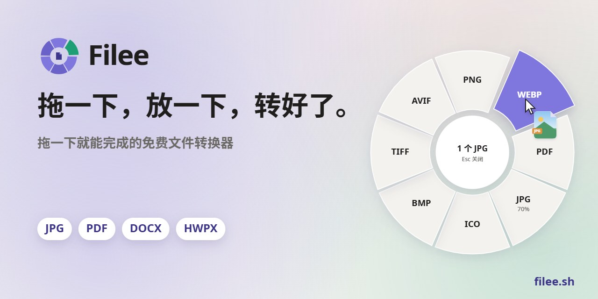
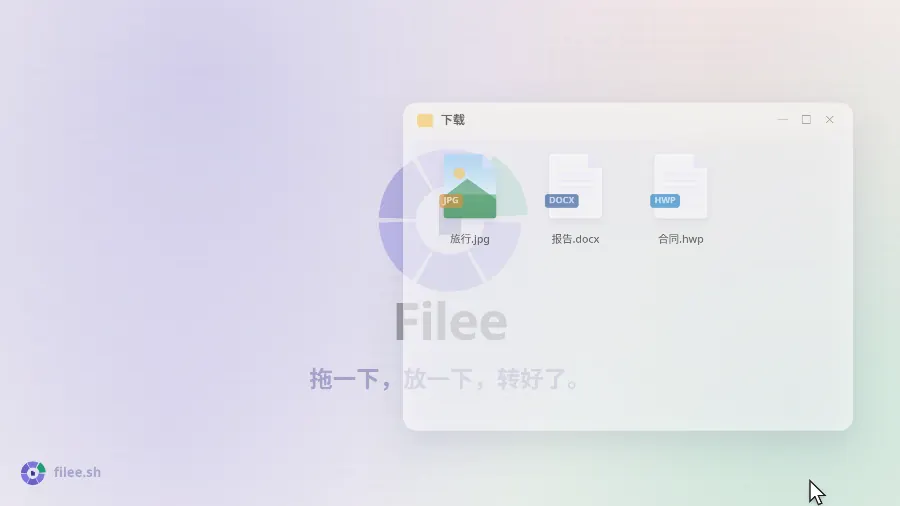
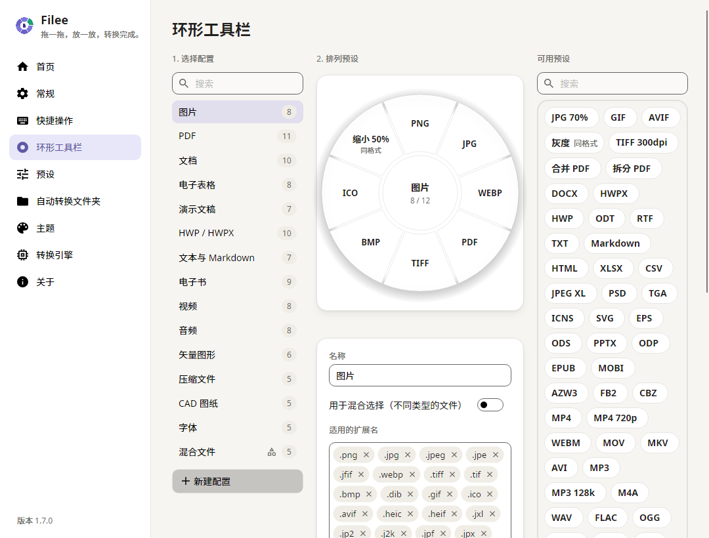

<p align="center">
  <a href="https://filee.sh/zh-cn/"></a>
</p>

<p align="center">
  <b>用拖放操作的免费开源文件格式转换器。</b><br>
  按住一个键（<kbd>Ctrl</kbd>，macOS 为 <kbd>Option</kbd>）拖动文件，光标处会弹出格式圆环，放到想要的格式上即可。
</p>

<p align="center">
  <a href="https://filee.sh/zh-cn/"><b>官网</b></a> ·
  <a href="https://github.com/WDHUS4G/Filee/releases/latest"><b>下载</b></a> ·
  <a href="#安装">安装</a> ·
  <a href="#命令行">命令行</a> ·
  <a href="#开发">开发</a>
</p>

<p align="center">
  <a href="https://github.com/KnifeLemon/Filee/actions/workflows/ci.yml"></a>
  <a href="https://github.com/WDHUS4G/Filee/releases/latest"></a>
  <a href="https://github.com/KnifeLemon/Filee/releases"></a>
  
  
  <a href="LICENSE"></a>
</p>

<p align="center"><a href="README.md">English</a> · <a href="README.ko.md">한국어</a> · <b>简体中文</b></p>

<table>
  <tr>
    <td width="33%" valign="top"><b>就在光标旁</b><br>无需打开应用窗口。只显示适合当前拖动文件的格式，就在你所在的位置。</td>
    <td width="33%" valign="top"><b>244 种格式，无需其他软件</b><br>图片、PDF、Word、Excel、PowerPoint、HWP、电子书、压缩包、字体、CAD 和 3D 模型，无需 Office、韩文办公软件或 LibreOffice。</td>
    <td width="33%" valign="top"><b>只在你的电脑上</b><br>不上传任何文件。Filee 离线工作，结果保存在原文件旁边。</td>
  </tr>
</table>

## 实际效果

<p align="center">
  <a href="https://filee.sh/zh-cn/"></a><br>
  <sub>27 秒视频和可交互演示请访问 <a href="https://filee.sh/zh-cn/">filee.sh</a></sub>
</p>

## 安装

从 [Releases](https://github.com/WDHUS4G/Filee/releases/latest) 下载。

- **Windows 10/11** 运行 `Filee-<version>-win-Setup.exe`，或解压 `win-Portable.zip` 后运行 `Filee.exe`。
  安装时可以添加资源管理器菜单、登录时启动、`filee` 命令和可选引擎。
- **macOS 14 及以上**（预览）解压 `osx-arm64` 或 `osx-x64` 包并运行 `./install.sh`。
  目前尚未公证，首次启动时请在系统设置 → 隐私与安全性中点 **仍要打开**。
- **Linux x64、ARM64**（预览）解压后运行 `./install.sh`（无需 root，需要 Python 3）。
  拖动手势需要 X11，Wayland 下请使用拖放区域和文件管理器的右键菜单。

有新版本时 Filee 会在菜单中提示，更新时保留设置和引擎。

## 功能

- **光标旁的圆环**，按住按键拖动文件，放到格式上即可。只显示适合这些文件的格式。
- **每种文件类型一个工具栏**，拖放排列。质量、尺寸、DPI、PDF 页面、视频音频、保存位置和文件名都能用预设设置。
- **一次转换多个文件**，并行处理。需要多步的转换（HWP → HWPX → DOCX）会自动找到路线。
- **监视文件夹**，放入的文件自动转换。
- **其他方式** 右键菜单、键盘快捷键、拖放区域和 [`filee` 命令](#命令行)。
- 浅色和深色主题，支持 English、한국어、简体中文。

## 截图

<table>
  <tr>
    <td width="50%"></td>
    <td width="50%"></td>
  </tr>
  <tr>
    <td align="center"><sub>拖放排列圆环，每种文件类型一个配置</sub></td>
    <td align="center"><sub>主页：拖放区和最近转换记录</sub></td>
  </tr>
</table>

## 支持格式

| 源格式 | 目标格式 |
|---|---|
| **图片**：JPG、PNG、WEBP、AVIF、TIFF、BMP、GIF、APNG、ICO、ICNS、JPEG XL、JPEG 2000、PSD/PSB、TGA、PPM、HEIC、QOI、DDS、PCX、MNG、CUR 等；GIMP XCF、相机 RAW（CR2、CR3、NEF、ARW、DNG 等）、DICOM、OpenEXR、HDR 仅读取 | 上述格式互转（HEIC⁵）、PDF、SVG（描摹）、缩放、灰度 |
| **矢量图**：SVG、SVGZ、EMF、WMF、AI · EPS、PS¹ · CDR、VSD、CGM、ODG、FODG² | PDF（矢量）、PNG 等图片、SVG ↔ SVGZ、SVG → DXF/DWG、PDF → EPS/PS¹、SVG → EMF、WMF、ODG² |
| **PDF** | DOCX、HWPX、TXT、PNG、JPG、TIFF、CBZ、SVG²；合并、拆分、页码范围 |
| **文档**：DOCX、DOCM、DOTX、EML、Outlook MSG · DOC、ODT、FODT、OTT、RTF、WPS、WPD、Pages、ClarisWorks、MacWrite、T602 等² | PDF、DOCX、HWPX、EPUB、TXT、HTML、MSG → EML · ODT、FODT、OTT² |
| **表格**：XLSX、XLSM、XLS、XLT、ODS、CSV、TSV · OTS、FODS、Numbers、ET² | PDF、XLSX、ODS、CSV、TSV、JSON、HWPX、HTML · XLT、OTS² |
| **演示文稿**：PPTX、PPTM、POTX、PPSX · PPT、ODP、OTP、FODP、Keynote² | PDF、PNG、JPG、DOCX、HWPX · OTP² |
| **HWP**：HWP、HWPX | PDF、PNG、DOCX、HWPX ↔ HWP、TXT、Markdown、HTML |
| **文本**：TXT、Markdown、HTML · reStructuredText、LaTeX、Org、AsciiDoc、Typst、MediaWiki、DocBook、Jupyter、Textile、man、OPML³ | PDF、DOCX、HWPX、EPUB · 互相转换、PPTX 幻灯片³ |
| **电子书**：EPUB、KEPUB、MOBI、AZW3、AZW、AZW4、FB2、CBZ、CBR、CB7、HTMLZ、TXTZ · LIT、LRF、CHM、PDB 等⁴ | PDF、EPUB、KEPUB（Kobo）、DOCX、TXT、HTML、HWPX · MOBI、AZW3⁴ |
| **视频**⁵：MP4、MOV、MKV、WEBM、AVI、WMV、FLV、MPEG、TS、M2TS、3GP、OGV、VOB 等 | MP4（H.264、HEVC、AV1）、WEBM、MOV、MKV、AVI、GIF、APNG、MP3、M4A、720p、字幕（SRT、ASS、WebVTT） |
| **音频**⁵：MP3、M4A、AAC、WAV、FLAC、OGG、OPUS、WMA、AIFF、AMR、APE、WavPack、TTA、DSD（DSF、DFF）、DTS、AC3、E-AC3 等 | MP3、M4A（AAC、ALAC）、WAV、FLAC、OGG、OPUS、AAC、WavPack、TTA、W64、AC3、E-AC3 |
| **字幕**：SRT、ASS/SSA、WebVTT、SAMI（SMI）、LRC、TTML、MicroDVD、SCC | 互相转换，保存为 UTF-8（也能读取 CP949 韩文字幕） |
| **压缩包**：ZIP、7Z、RAR、TAR、TAR.GZ、TAR.BZ2、TAR.XZ、GZ、ISO、CAB、DMG、ALZ、EGG 等 | 解压、ZIP、7Z、TAR、TAR.GZ；多个文件 → 一个 ZIP |
| **CAD**：DWG、DXF | PDF、SVG、PNG、DWG ↔ DXF |
| **字体**：TTF、OTF、WOFF、WOFF2、EOT | 互相转换 |
| **数据**：JSON、JSON Lines、YAML、TOML、XML · vCard | 互相转换、CSV 和 XLSX（表格数据）、vCard ↔ CSV |
| **3D 模型**：GLB、glTF、STL、OBJ（+ MTL）、3MF、PLY | 互相转换、PNG 预览 |

未标注的格式装好即用，无需 Office、韩文办公软件或 LibreOffice。
标注的格式需要可选引擎，只在需要时下载，分别是 ¹ Ghostscript、² LibreOffice、³ Pandoc、⁴ calibre、⁵ FFmpeg
（[详情](docs/ENGINES.md)）。

## 命令行

`filee` 命令使用与应用相同的引擎和预设（安装程序或 `install.sh` 会添加它）。

```
filee convert photo.heic --to jpg
filee convert *.png --to webp --quality 80 -o converted
filee watch D:\Inbox --to pdf --move-originals
```

全部命令和选项见 [filee.sh/zh-cn/cli](https://filee.sh/zh-cn/cli/) 或 `filee help`。

## 开发

在 Windows、macOS 或 Linux 上使用 .NET 10 SDK 构建。

```bash
git clone https://github.com/KnifeLemon/Filee.git
cd Filee
pwsh build/fetch-engines.ps1 -Only rhwp,pandoc   # optional engines
dotnet run --project src/Filee.App
dotnet test
```

[架构](docs/ARCHITECTURE.md) · [引擎](docs/ENGINES.md) · [添加转换器](docs/ADDING-A-CONVERTER.md) ·
[添加语言](docs/ADDING-A-LANGUAGE.md) · [贡献指南](CONTRIBUTING.md)

欢迎提交 Pull Request。如果 Filee 帮你省了时间，点个 ⭐ 能让更多人发现它。

## 代码签名政策

Filee 由 **Myeonggu Kim**（[KnifeLemon](https://github.com/KnifeLemon)）开发和发布。
Windows 版本将使用颁发给 Myeonggu Kim 的 [Certum](https://www.certum.eu/) 开源代码签名证书签名，证书正在办理中。

详细政策和隐私政策见[英文 README](README.md#code-signing-policy)。
Filee 不会上传文件，也不会发送任何使用数据。

## 赞助

Filee 免费，并将一直免费。想支持开发的话，选一种方便的方式即可。谢谢！

**你的名字或标志可以出现在这里。** 按月赞助者的名字会列在这里，标志档位的标志会显示在这里和 Filee 的“关于”页面。
一次性赞助的朋友也可以要求列出名字。

<!-- sponsors: src/Filee.App/Assets/Sponsors/sponsors.json -->

<p align="center">
  <a href="https://github.com/sponsors/KnifeLemon"></a>
  <a href="https://patreon.com/KnifeLemon"></a>
  <a href="https://ko-fi.com/knifelemon"></a>
  <a href="https://paypal.me/knifelemon"></a>
  <a href="https://fairy.hada.io/@filee"></a>
</p>

## 许可证

MIT，© 2026 Myeonggu Kim (KnifeLemon) 和 Filee 贡献者。随附的第三方组件遵循各自的许可证，详见 [THIRD-PARTY-NOTICES.md](THIRD-PARTY-NOTICES.md)。

<p align="center">
  <a href="https://star-history.com/#KnifeLemon/Filee&Date"></a>
</p>
